# Health Claim Decision Agent — Project Explainer

> **⚠️ SYNTHETIC DATA ONLY.** This is a portfolio backend for AI-assisted,
> evidence-grounded health-insurance **claim decision support**. It is **not** real
> insurance authorization, medical advice, or a production decision engine. Every
> policy, patient, provider, and claim is fabricated.

This document explains the whole project with diagrams. For the terse,
text-only architecture reference see [`ARCHITECTURE.md`](ARCHITECTURE.md); for
deployment see [`docs/aws-ecr-deploy.md`](docs/aws-ecr-deploy.md).

---

## 1. What it is

A synthetic health-insurance **claim** comes in. The system:

1. **Extracts** structured facts from it with an LLM (schema-constrained + validated),
2. **Retrieves** the most relevant **policy clauses** via RAG (PostgreSQL + pgvector,
   embeddings from **NVIDIA NIM**),
3. runs **deterministic business rules**,
4. and — only if the rules raise no hard objection — asks a **decision model**
   (**Parallel Decisions Fast** via OpenRouter) for a judgment with a probability per outcome.

A Java **orchestrator** fuses rules + AI into a final, auditable decision —
**APPROVE / REJECT / HUMAN_REVIEW** — grounded in retrieved evidence. Every stage can
be **streamed live** (Server-Sent Events) to the React demo UI, which draws each stage
as a 3D check with its real timing. Humans can override; everything is recorded in an
append-only **audit trail**.

**Core idea:** *Java owns the verdict; the AI only assists.* Rejections are always
rule-driven; the AI can never cause an ungrounded approve/reject; any AI or RAG
failure routes to a human.

**Nothing is hidden.** The demo UI shows the whole policy rulebook live from
PostgreSQL (the terms the rules check and the wording indexed in pgvector), and for
every analysis the exact package the decision model was given and what it answered (§6).

**Live:** https://d97tm0469lmul.cloudfront.net (AWS Lambda + CloudFront, §15).

---

## 2. High-level architecture

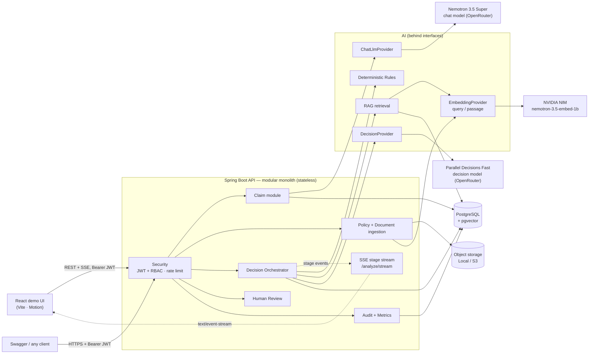

Every external dependency (decision model, chat LLM, embeddings, object storage) sits
behind an interface chosen by configuration, so providers swap without touching
business logic — and the whole stack runs offline with zero API keys for dev/CI.

---

## 3. Technology stack

| Layer | Choice |
|------|--------|
| Language / runtime | Java 21 (built on JDK 25, targets release 21) |
| Framework | Spring Boot 3.5 (Web, Validation, Data JPA, Security, Actuator) |
| Database | PostgreSQL 16 + **pgvector** (HNSW cosine index) |
| Migrations | Flyway `V1`–`V4` (`ddl-auto=validate`) |
| AI judge | **Parallel Decisions Fast** decision model via OpenRouter's Decisions API — typed choice, probability per outcome |
| AI (extraction, explanation) | `nvidia/nemotron-3.5-super-vl:free` via OpenRouter — OpenAI-compatible, strict JSON schema |
| Embeddings | **NVIDIA NIM** `nemotron-3.5-embed-1b` (384-d, query/passage) **or** local deterministic (offline) |
| Streaming | Spring `SseEmitter` on a dedicated executor (MDC + security context carried over) |
| Resilience | Resilience4j (timeout, retry, circuit breaker); bounded retry for embeddings |
| PDF | Apache PDFBox |
| Security | Spring Security + JWT (jjwt, HMAC-SHA), BCrypt |
| Observability | Micrometer + Prometheus, structured JSON logs |
| Storage | Local FS (dev) / S3-compatible (deploy, AWS SDK v2) |
| Demo UI | React 19, TypeScript, Vite 6, Motion |
| Testing | JUnit 5, Mockito, Testcontainers, MockWebServer, MockRestServiceServer, LocalStack, Vitest (**122 backend + 23 frontend tests**) |
| Ship | Maven (`./mvnw`), multi-stage Docker, GitHub Actions, AWS ECR + Lambda |

---

## 4. Claim lifecycle (status machine)

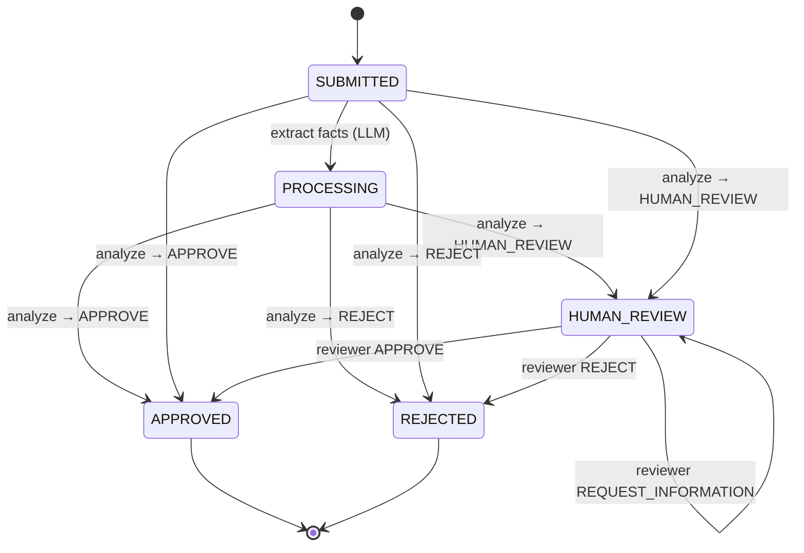

---

## 5. The decision engine (the core)

Deterministic rules run first and aggregate with strict precedence
**REJECT > REVIEW > ALLOW**. The AI is consulted **only on ALLOW** — which both
enforces "Java owns rejects" and avoids unnecessary AI spend.

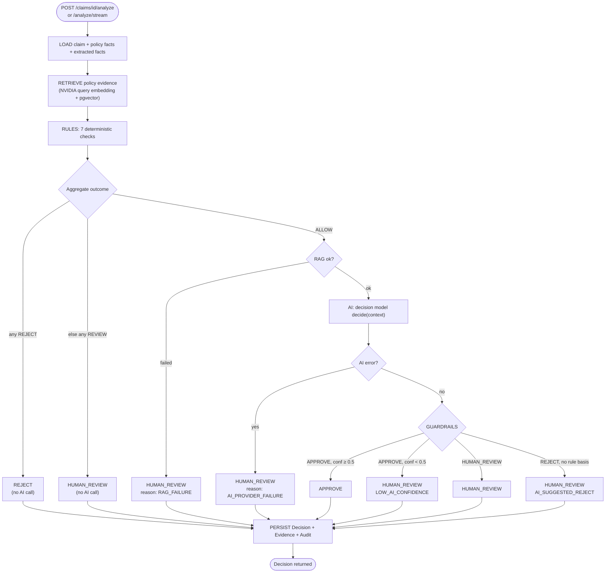

**The 7 rules**

| Rule | On violation | Reason code |
|------|------|-------------|
| Policy active & in force | REJECT | `POLICY_EXPIRED` / `POLICY_CANCELLED` / `POLICY_NOT_EFFECTIVE` |
| Procedure/diagnosis excluded | REJECT | `PROCEDURE_EXCLUDED` |
| Within coverage limit | REVIEW | `CLAIM_EXCEEDS_COVERAGE_LIMIT` |
| Waiting period satisfied | REJECT | `WAITING_PERIOD_VIOLATION` / `PRE_EXISTING_WAITING_PERIOD` |
| Required info present | REVIEW | `MISSING_REQUIRED_INFORMATION` |
| No conflicting facts | REVIEW | `CONFLICTING_INFORMATION` |
| Pre-existing status known | REVIEW | `PRE_EXISTING_STATUS_UNKNOWN` |

**Where the time goes** (one AI-approved demo claim):

| Stage | Time | What dominates |
|-------|------|----------------|
| Load | ~20 ms | local Postgres, pooled connections |
| Retrieve | ~275 ms | one NVIDIA query embedding; the vector search itself is a few ms |
| Rules | <1 ms | in-memory Java |
| AI judge | ~0.8–2 s | one decision-model call (790 ms live on AWS); it returns probabilities, not generated text |
| Guardrails | ~0 ms | comparisons in Java |
| Persist + audit | ~85 ms | decision, evidence snapshot, audit row |

A claim the rules decide skips the AI entirely and finishes in well under a second.

---

## 6. Who decides, and what the AI sees

**Java decides.** A claim is approved automatically only when all eight conditions
hold. Six are Java rule checks over the policy's terms in PostgreSQL; the AI advises
on one; a Java guardrail has the last word.

| # | Condition for an automatic APPROVE | Checked by |
|---|------------------------------------|------------|
| 1 | The policy is active and in force on the treatment date | Java rule |
| 2 | The procedure and diagnosis are not excluded by the policy | Java rule |
| 3 | The amount is within the coverage limit | Java rule |
| 4 | General and pre-existing waiting periods have passed | Java rule |
| 5 | Pre-existing condition status is known | Java rule |
| 6 | Every required fact is present and none conflict | Java rules |
| 7 | The decision model weighs the claim against the retrieved policy wording and picks APPROVE | **Decision model (advisory)** |
| 8 | Its probability for APPROVE is at least 0.5, so Java accepts the suggestion | Java guardrail |

If a rule fails, the rules decide (REJECT or HUMAN_REVIEW) and the decision model is
never called. If it is unsure, suggests a REJECT no rule supports, or fails, Java sends
the claim to a person.

**What the decision model receives.** `DecisionPromptPayload` builds one JSON package
from the decision context. It is the model's `state`, and the same object is sent to the
UI on the `AI STARTED` stream event, so what the UI shows is what the model got. The
request asks one `choice` question whose options are the three outcomes, each with a
written criterion. From a live run on AWS (CLM-SYN-005, trimmed):

```jsonc
{
  "claim":  { "diagnosis": "Kidney stones", "procedure": "Ureteroscopy",
              "treatment": "2-day inpatient", "claimAmount": 110000, "currency": "INR" },
  "policy": { "coverageLimit": 1000000,
              "exclusions": ["Cosmetic surgery", "Infertility treatment"] },
  "extractedFacts": [ { "key": "diagnosis", "value": "Kidney stones", "status": "KNOWN" },
                      { "key": "procedure", "value": "Ureteroscopy", "status": "KNOWN" } /* 5 in all */ ],
  "policyEvidence": [ { "page": 1, "text": "… or gallstones or cholecystitis. 3.2 Appendectomy: …" } /* top 3 from pgvector */ ],
  "ruleReasonCodes": [ "NO_CONFLICTING_INFORMATION", "WITHIN_COVERAGE_LIMIT", "NO_EXCLUSION_MATCH",
                       "REQUIRED_INFORMATION_PRESENT", "POLICY_ACTIVE", "PRE_EXISTING_STATUS_KNOWN",
                       "WAITING_PERIOD_SATISFIED" ]
}
```

No patient identity, claim or policy ids, provider or dates reach the model; dates are
checked by the Java rules. On that run the decision model answered in **790 ms**:

```jsonc
{ "decision": { "type": "choice", "choice": "APPROVE",
                "probabilities": { "APPROVE": 0.92, "HUMAN_REVIEW": 0.08, "REJECT": 0.00 } } }
```

The probability of the chosen outcome (0.92) is the confidence the guardrails check:
above 0.5, with no rule objecting, so Java made it the final APPROVE.

**Why a decision model.** The judge picks one of three outcomes; it does not need to
write prose. A decision model returns calibrated probabilities directly, in about a
second, which is several times faster than the LLM judge it replaced (Mercury 2.5,
3–5 s, retired by OpenRouter in November 2026) and easier to put guardrails around.
In testing it also caught what the text-matching rule cannot: for a rhinoplasty claim
whose exclusion list says "cosmetic surgery", it answered REJECT at 85% from the
policy wording. That AI-only rejection still goes to a person.

**Whole clauses, not fragments.** Each retrieved chunk goes in whole (~1000
characters). It used to be cut to 500, which dropped POL-SYN-001's covering clause
("3.1 Laparoscopic cholecystectomy …", at character ~800); with it, the model's
confidence on CLM-SYN-001 rose from 64–84% to 97%.

**It can consult the web.** Decision models research the live web; the sources it
used come back with the answer and are shown in the UI. Because the policy is
fictional, only the evidence in the state should count, which is one more reason the
AI can never reject on its own.

---

## 7. Sequence — analyze a claim

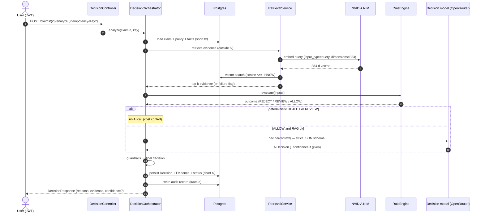

---

## 8. Sequence — live stage stream (SSE)

`POST /claims/{id}/analyze/stream` runs the same orchestrator with a listener that
emits one event per stage transition. Timings are measured on the server.

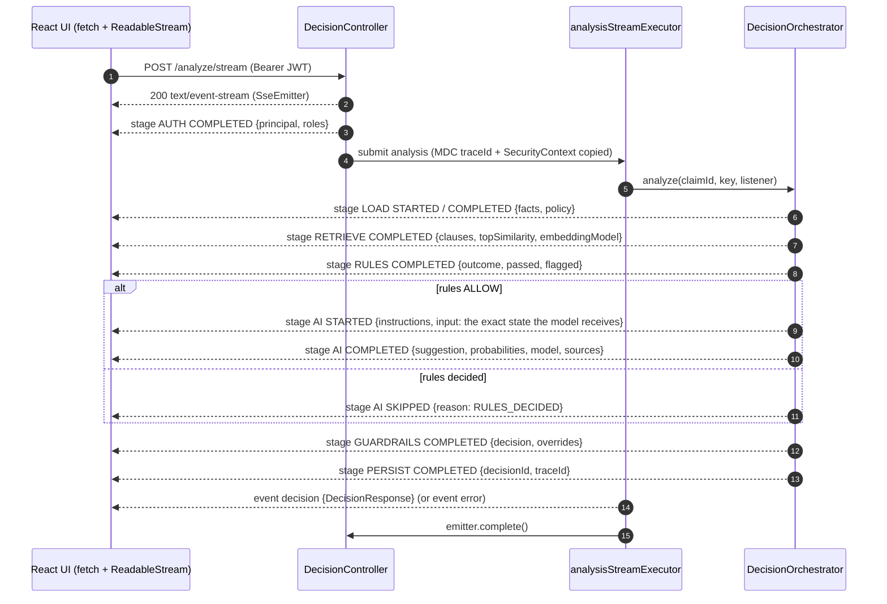

- `EventSource` cannot send an `Authorization` header, so the UI reads the stream with
  `fetch`. It keeps each cube on screen for at least ~0.5 s so sub-millisecond stages
  can be followed; the AI cube spins for exactly as long as the decision model takes.
- The completion re-enters Spring Security as an ASYNC dispatch, which is permitted;
  the rate limiter skips it so a stream is charged once.

---

## 9. Sequence — ingest a policy document (RAG index build)

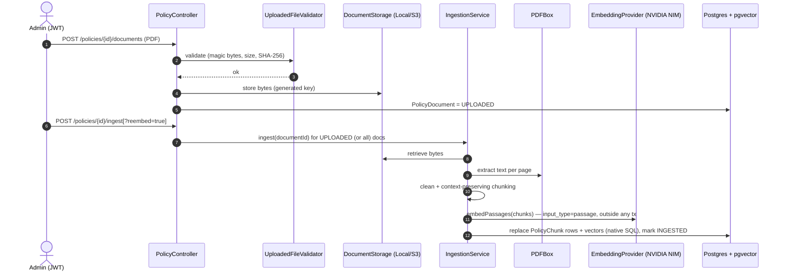

`reembed=true` rebuilds every document's chunks with the current embedding model —
used when switching from the local embedder to NVIDIA
(`python scripts/seed_policy_documents.py --reingest`).

---

## 10. RAG pipeline

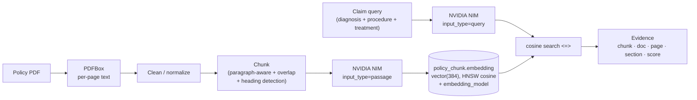

`nemotron-3.5-embed-1b` is an **asymmetric** retrieval model (queries and passages
are embedded differently) and a **Matryoshka** model: it natively produces 2048-d
vectors but can return 384-d ones, which fit the existing `vector(384)` column with no
migration. Every policy-based decision is traceable to the retrieved chunk (document,
page, section, similarity) — stored as a `decision_evidence` snapshot.

---

## 11. Provider abstractions

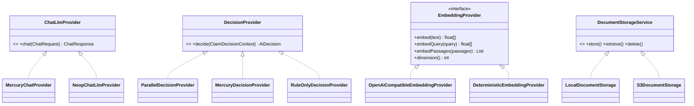

Each interface has a **production** implementation and an **offline default**, chosen
by configuration (`app.decision-model.engine`, `app.mercury.provider`,
`app.embedding.provider`, `app.storage.provider`). Resilience4j wraps the chat HTTP calls (timeout + retry
on transient failures + circuit breaker). The embedding client sends `input_type`,
`dimensions` and `truncate` only when configured, retries 5xx up to 3 attempts, and
checks every vector's dimension. The chat model reasons before answering, so its calls allow up
to 4096 output tokens.

---

## 12. Data model

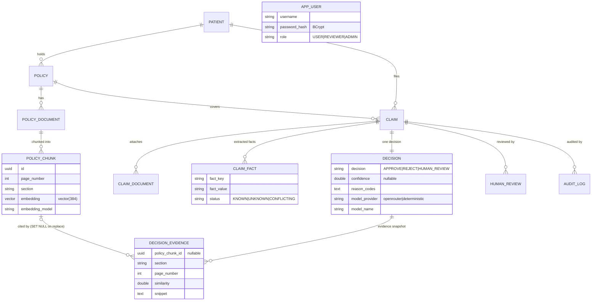

Conventions: UUID keys; enums as `VARCHAR` + `CHECK`; one `decision` per claim
(re-analysis upserts); the `embedding` column is managed by native SQL (unmapped by
JPA) so the vector dimension stays decoupled from the entity. Schema is owned by
Flyway (`V1__init_schema.sql`, `V2__users.sql`,
`V3__evidence_survives_reingestion.sql`, `V4__decision_summary.sql`).

---

## 13. API surface (v1)

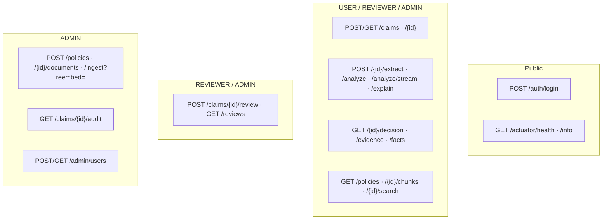

Rate limiting protects the expensive AI endpoints (`/analyze`, `/analyze/stream`,
`/extract`, `/explain`, `/ingest`) → `429` when the per-caller allowance is exceeded.
All errors return a consistent envelope with a `traceId`.

---

## 14. Security

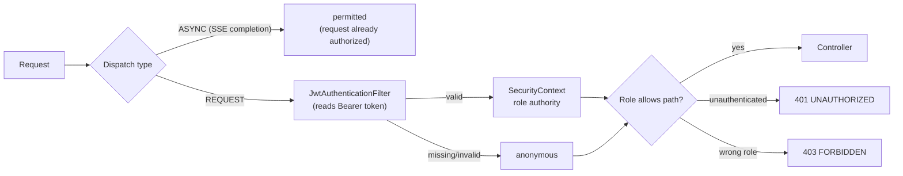

Stateless JWT (HMAC-SHA; jjwt picks HS256/384/512 from the secret's length — the dev
secret gives HS384), BCrypt passwords, env-driven CORS (no wildcard in prod), secrets
(JWT, DB, OpenRouter, NVIDIA) via env / gitignored `.env` / AWS Secrets Manager,
tokens and keys never logged.

---

## 15. Deployment (live on AWS)

Live at **https://d97tm0469lmul.cloudfront.net**. Infrastructure is one CloudFormation
template ([`infra/aws/template.yaml`](infra/aws/template.yaml)); every push to `main`
that passes CI is deployed by GitHub Actions through OIDC.

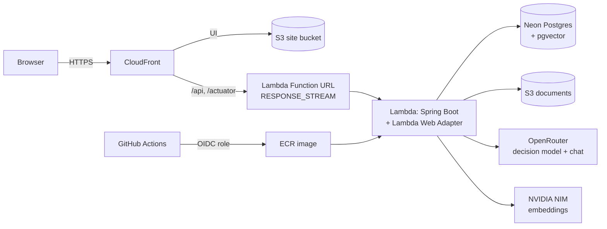

- **Live SSE on Lambda:** the Function URL streams and the Web Adapter runs in
  `response_stream` mode, so the stage events reach the browser as they happen.
- **One origin:** CloudFront serves the UI and forwards the API, so there's no CORS. Its
  request policy drops the browser's `Origin` header, which Spring's CORS check would reject.
- **Start-up:** the adapter waits for readiness, so Lambda never freezes the app while
  it is still seeding; a cold start takes ~30 s.
- **No keys in GitHub:** app secrets live only in the Lambda's configuration; the deploy
  role can only push this image, update this function and publish this site.
- **Public-demo profile:** demo accounts, 5 AI calls per minute per account, and shared
  data read-only except for a private operator account.

The **same image** (built from `Dockerfile`, without the adapter) runs on ECS Fargate /
App Runner / Cloud Run with no code changes.

---

## 16. Testing & evaluation

- **122 backend tests** — unit (rules, extractor normalization, embedders, chunker,
  embedding request shape / retry via MockRestServiceServer), contract (chat client via
  MockWebServer: retry / timeout / circuit breaker), integration (Testcontainers
  pgvector + LocalStack S3: APIs, RAG, re-embed, SSE stage order, evidence surviving
  re-ingestion), and security (JWT + RBAC). All offline — no paid APIs in CI.
- **Evaluation harness** over a **labeled synthetic dataset** (5 policies, 30 claims)
  computes accuracy, per-class precision/recall/F1, false-approval/rejection rates,
  human-review rate, latency, cost. The offline RULE_ONLY arm reproduces the
  rule-grounded labels (**accuracy 1.000**) as a consistency check; LLM/hybrid arms
  plug in when a provider is configured. See
  [`docs/evaluation-report.md`](docs/evaluation-report.md).

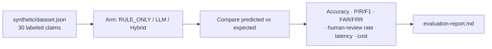

---

## 17. Demo UI

A React 19 + TypeScript + Vite 6 app (Motion for animation) in Apple's design
language. Every number on it comes from the running backend.

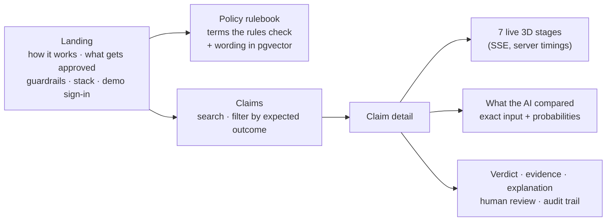

- **Pipeline:** each stage is a cube that spins while running and lands on ✓ / ✕ / ! / –,
  with the real technology chips and live details (clauses and embedding model, rules
  passed or flagged, the decision model's probabilities, guardrail overrides, ids).
- **What the AI compared:** the claim, the policy terms, the retrieved clauses, the
  facts and rule results the decision model received, its probability for each outcome
  as bars, any web sources it consulted, and Java's ruling, or why it was not called. The raw prompt and JSON are one click away.
- **Plain-English explanation:** verdict, why (checks and the AI's probabilities), the
  policy sentence that names the procedure, and what to check. It says who wrote it: the
  chat model, or the template when the free model is busy or slower than 40 s.
- **Policy rulebook:** every policy from PostgreSQL with the rule each term feeds, and
  its indexed wording (`GET /policies/{id}/chunks`, embedding model and dimensions).
- **Roles:** one-click dev accounts for admin, reviewer and user; review and audit
  panels follow the role. Dark and light themes, reduced motion and reduced
  transparency are handled.
- The Vite dev proxy forwards `/api` and `/actuator` to `:8080` and drops the browser's
  `Origin` header (the request is same-origin through the proxy), so the UI works on
  whichever port Vite picks.

---

## 18. Run it locally

```bash
# Postgres (pgvector) + backend, zero API keys needed
docker compose up --build          # use DB_HOST_PORT=5433 if 5432 is taken

# or run tests
./mvnw clean verify                # 122 backend tests (needs Docker for Testcontainers)
cd frontend && npm test            # 23 frontend tests (Vitest)
```

Real AI is configuration only (in `.env`): `MERCURY_PROVIDER=openrouter` + key/model
for the judge, and the `EMBEDDING_*` NVIDIA block from `.env.example` for semantic
retrieval. Then index the synthetic policy wording and start the UI:

```bash
python scripts/seed_policy_documents.py      # add --reingest after changing embedding models
cd frontend && npm install && npm run dev    # http://localhost:5173
```

Sign in as a demo role, open **Rulebook** to see what claims are checked against, then
open a claim and press **Analyze** to watch the stages and the AI's input live.

Dev seeds synthetic users (`admin` / `reviewer` / `user`) and the synthetic
policies + claims. Swagger UI at `/swagger-ui.html` (dev only, with an Authorize
button for the bearer token).

---

## 19. Limitations & future work

- Both AI models use OpenRouter's **free tier** (daily request cap; the chat model
  queues for 30–50 s), so explanations often come from the template. A paid chat model
  is a one-line configuration change.
- Authorization is **role-based**; per-row claim ownership (a USER seeing only their
  own claims) is a documented future enhancement.
- Analysis runs inside the request (plain or streamed); the async job model (`202` +
  `GET /jobs/{id}`) is designed for but not implemented (matters most under Lambda's
  29 s cap).
- The synthetic policy wording is short, so similarity scores are modest (~0.1–0.3)
  even though the ranking is sensible.
- NVIDIA's free endpoint is called with one input per request because multi-input
  batches fail intermittently.
- The demo sign-in accounts are dev-only and must not ship in a public deployment.
- **The AI's added value is not measured yet.** The evaluation's RULE_ONLY arm scores
  30/30 because the dataset labels are rule-grounded, so it is a consistency check,
  not a result. The hybrid (rules + AI judge) arm is supported by the harness but has
  not been run.
- Front-end tests cover the logic (stream parsing, stage mapping and pacing,
  formatting), not rendered components; the UI itself is checked in the browser.
